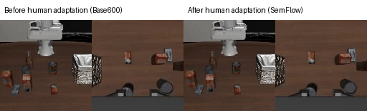
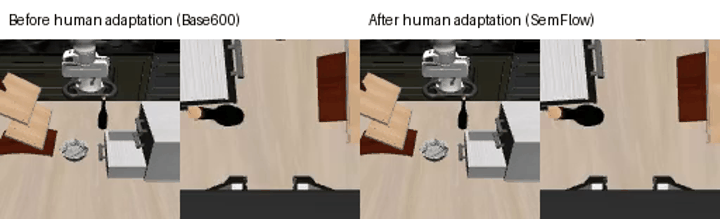
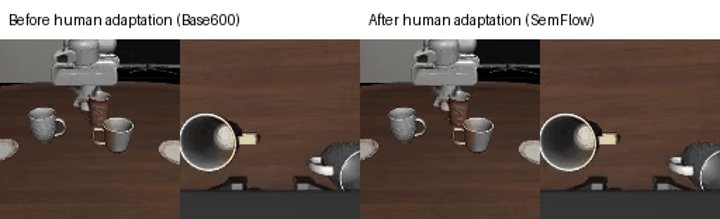

# SemanticFlow (SemFlow)

**Research question:** can an action model learn useful world knowledge from human video, then exploit it for downstream action adaptation?

This pilot adapts future scene representations from three personally recorded human RGB clips and ordinary task instructions. It does not retarget human movements into robot actions. A source-calibrated EgoSteer model predicts future features; a learned interface exposes those predictions to Panda action generation. Source robot demonstrations are required for calibration.

**Finding:** this implementation did not demonstrate useful action adaptation. SemFlow's mean improvement over a source-retention-only control was **0.0248%**. Every human-adapted model worsened sampled source action error relative to the frozen initialization. We paused this implementation; the broader research question remains open.

**AI assistance:** This is a solo project by Eduardo Mosca, developed with assistance from OpenAI Codex. Uses of “we” throughout the repository refer to the author working with that AI assistance, rather than a team of human researchers. The author is responsible for the work and its claims.

## Our egocentric demonstrations and intended LIBERO targets

One personally recorded chest-level RGB clip per target. The simulator previews below are **LIBERO-90 source-dataset demonstrations of the two component tasks**, not composed LIBERO-10 target rollouts or outputs of our adapted policy.

| Human input used for adaptation | LIBERO component 1 — dataset example | LIBERO component 2 — dataset example |
|---|---|---|
| **Jar + carton → box**<br> | **Alphabet soup → basket**<br> | **Tomato sauce → basket**<br> |
| **Cream/grey cups → left/right plates**<br> | **White mug → left plate**<br> | **Yellow/white mug → right plate**<br> |
| **White bowl → drawer; close it**<br> | **Black bowl → bottom drawer**<br> | **Close bottom drawer**<br> |

The intended LIBERO-10 targets combine each row's two components. See [exact target names, full human videos, and provenance](docs/demo_showcase.md). Human adaptation ran for these three mappings. One qualitative adapted-policy attempt per target is shown below; the planned multi-seed benchmark matrix was not run.

## Before and after human adaptation

The side-by-side videos compare **frozen Base600 before human adaptation** (left) with **SemFlow after human adaptation** (right). Each pair uses the same target, initial-state index 0, seed 10000, action-noise sequence, ten-step sampler, controller conversion, and 400-step limit. Both models reached the step limit without simulator success on all three targets. These are qualitative attempts, not a benchmark success-rate estimate; no improvement is claimed.

| Target | Before → after: learned-policy comparison | Full videos |
|---|---|---|
| Two foods → basket |  | [Side by side](assets/rollouts/paired/basket_two_foods-comparison.mp4) · [Before](assets/rollouts/paired/basket_two_foods-before.mp4) · [After](assets/rollouts/paired/basket_two_foods-after.mp4) |
| Bowl → drawer; close |  | [Side by side](assets/rollouts/paired/bowl_drawer_close-comparison.mp4) · [Before](assets/rollouts/paired/bowl_drawer_close-before.mp4) · [After](assets/rollouts/paired/bowl_drawer_close-after.mp4) |
| Two mugs → respective plates |  | [Side by side](assets/rollouts/paired/mugs_two_plates-comparison.mp4) · [Before](assets/rollouts/paired/mugs_two_plates-before.mp4) · [After](assets/rollouts/paired/mugs_two_plates-after.mp4) |

Within each model panel, the fixed agent camera is on the left and the wrist camera on the right. Full MP4s contain 401 frames at 20 Hz with no speed change. GIF previews sample approximately six frames per second with rounded timing. [Media provenance](assets/rollouts/paired/provenance.json) records the checkpoint, adapter, task, and video hashes. The source-dataset examples above remain distinct from these learned-policy target executions.

The already measured before/after **offline source-validation action errors** are:

| Human clip used for adaptation | Before: frozen Base600 | After: SemFlow | Change ↓ |
|---|---:|---:|---:|
| Box / basket mapping | 1.552688 | 1.570225 | +1.13% (worse) |
| Drawer mapping | 1.552688 | 1.570691 | +1.16% (worse) |
| Cups / plates mapping | 1.552688 | 1.570584 | +1.15% (worse) |

Values are normalized first-eight-action MSE at ten sampling steps, averaged across the same 12 source-validation windows and four paired action-noise seeds. Each adapted model is evaluated across all six source tasks; these are not target rollout errors. The shared frozen value is repeated for comparison.

## Experiment and results

Starting from the same source-calibrated checkpoint, we compared frozen inference, standard future-feature adaptation, and semantic-state/transition adaptation (SemFlow). Each human task had one clip, one seed, and 60 updates per method. Only a shared rank-8 adapter with 1,605,632 parameters was adapted.

Source data comprised 248 training and 52 validation robot episodes across six tasks. The action panel sampled 12 validation windows with four paired action-noise seeds. These are not four independent training runs.

| Primary offline endpoint | Normalized first-eight-action MSE ↓ |
|---|---:|
| Source training-mean baseline | 1.036449 |
| Frozen common model | 1.552688 |
| Source-retention-only control | 1.570889 |
| SemFlow after each human clip | 1.570225–1.570691 |


Bypassing the entire scene conditioner lowered frozen error to 1.285209, about 17%, but still lost to the mean baseline. This removes current and future scene injection together; it does not isolate the forecast contribution. An earlier source simulator evaluation completed 17 trials with zero successes before timing out. No human-adapted target-task success result is claimed.

See the [research report and decision chain](docs/research_report.md).

## Reproduce the numbers

With Python 3.10 or later, from the repository root:

```bash
python3 tools/reproduce_results.py --results results
```

This standard-library command verifies evidence hashes and paired sample coverage, and recomputes the diagnostic decision. It does not rerun training or simulation. To regenerate the figure, install Matplotlib and NumPy, then run:

```bash
python3 tools/plot_submission.py
```

Software checks, with the optional research dependencies available:

```bash
PYTHONPATH=src:tools python3 -m unittest discover -s tests -q
```

See [reproducibility and v0 limits](docs/reproducibility.md) for evidence contents and GPU-stage documentation.

## Constraints and v0 scope

**Simulation-only: no robot hardware was available.** The application allowed two weeks, with a deadline of 16 October 2026, 23:59 BST. GPU experiments used a cloud A100 80 GB. Measured human-training peak allocation was 7.27 GiB; this is not a minimum GPU requirement. See [project information, time, and compute](docs/project_constraints.md).

This v0 includes research code, verified numerical evidence, a reproducible figure, and the experiment narrative. The three human videos and source-component previews are included. A clean-machine end-to-end training recipe remains pending. Human forecast losses measure fit to overlapping training-clip windows, not held-out human generalization. The planned multi-seed target rollout matrix was not run.

Upstream EgoSteer notices are preserved under [licenses/egosteer](licenses/egosteer/NOTICE). Model and dataset access and licenses apply separately. No project-wide reuse license has been selected for v0.
