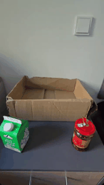
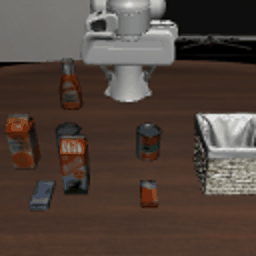
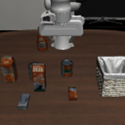
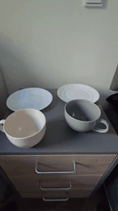
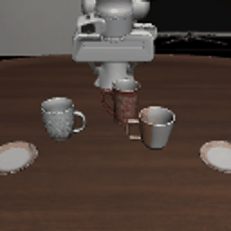
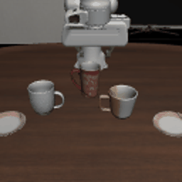
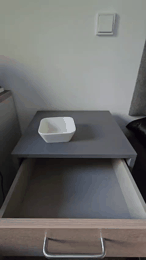
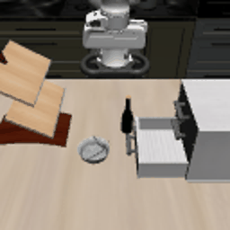
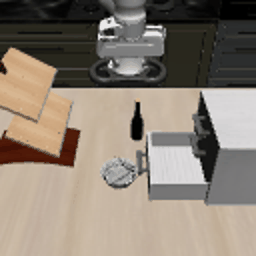

# SemanticFlow (SemFlow)

Can a robot learn something useful about how the world changes by watching a person do a task once?

World-action models (WAMs) combine learning how the world changes with learning how to act. EgoSteer pairs an action expert with a world expert trained to predict future DINOv3 visual features—numerical descriptions of image regions—as an additional training task. We treat these features as a possible proxy for scene meaning: “semantic flow” is how a compact representation of them guided by the task instruction changes over time. SemFlow adapts EgoSteer to learn these changes from human video and explicitly feeds its predicted scene representations into action generation. Whether those representations capture useful task semantics remains an open question.

## TL;DR

- **The idea:** a human and a robot move differently, but they can cause similar changes: a cup ends up on a plate, an object goes into a drawer, or the drawer closes. We asked whether learning to predict those changes from human video could help a robot act.
- **The model:** we started with pretrained EgoSteer and used frozen DINOv3 visual features to represent scenes. Robot demonstrations from six initial LIBERO tasks (our “source” tasks) taught the model how to work with Panda robot states and actions, and connected its scene predictions to action generation. This starting point still had weak robot control.
- **The training:** we recorded three first-person RGB videos, one per intended task, and adapted a small part of the model using video and task instructions. The human clips supplied no action labels. No robot demonstrations of the intended target tasks were used for adaptation.
- **The comparison:** ordinary adaptation learned to predict future visual features. SemFlow added losses for a compact scene representation and how it changes over time, with the aim of learning task-relevant changes. Both also continued training on recorded commands from those source robot tasks to limit forgetting. We compared them with the unchanged model and with source rehearsal alone, first at 60 updates and then at 300.
- **What we saw:** at 300 updates, SemFlow's error against recorded source robot actions was about 3.7% higher than the unchanged model's, and very close to both adaptation controls. Earlier simulator attempts, one per target for each of the frozen and SemFlow models, completed none of the three tasks. We stopped at 300 under the experiment's continuation rules.
- **What we can conclude:** we have not shown a benefit from this setup. Action error is only a diagnostic: matching recorded actions more closely does not necessarily mean completing tasks more often. With weak starting control, one human clip per task, one training seed, and no completed multi-seed target benchmark, we cannot reliably judge whether SemFlow improves robot task performance. The broader research question remains open.

**AI assistance:** This is a solo project by Eduardo Mosca, developed with assistance from OpenAI Codex. Uses of “we” throughout the repository refer to the author working with that AI assistance, rather than a team of human researchers. The author is responsible for the work and its claims.

## Semantic flow as a training objective

A few terms used below:

| Term | Meaning here |
|---|---|
| **Raw features** | DINOv3's numerical descriptions of image patches, before we compress them into scene tokens. “Raw” refers to these features, not image pixels. |
| **Future features** | Those descriptions for a later frame. During training we extract them from the recorded future frame; the model learns to predict them using only what it has observed so far. “Raw” and “future” describe different aspects of the same features. |
| **Scene tokens** | Sixteen learned vectors that summarize the image features using the task instruction. Their changes over time are what we call semantic flow. |
| **Source actions** | Recorded robot commands from the six initial LIBERO tasks. Continuing to train on them is called rehearsal or retention; it is intended to limit forgetting during human-video adaptation. |
| **Teacher and targets** | The fixed DINOv3 encoder and scene readout produce reference representations from recorded frames. These references are the targets that predictions are trained to match. |

We ask the model to predict both **the representation of each future scene** and **how that representation changes**. MSE means mean squared error: the average squared difference between predicted and reference numbers:

$$
\mathcal{L}_{\mathrm{sem}} =
\underbrace{\operatorname{MSE}(\hat z, z)}_{\text{match future scene states}}
+ \underbrace{\operatorname{MSE}(\Delta\hat z, \Delta z)}_{\text{match changes between future states}}.
$$

Here, $z$ is the reference scene representation of actual future frames, and $\hat z$ is the model's prediction. Both are put on a common scale using the mean and standard deviation of each feature coordinate, measured on source robot training data. The state term averages over the 0.5, 1, and 2 second horizons; the change term compares adjacent horizons, with $\Delta z_i = z_{i+1}-z_i$. These are feature differences, not optical flow or rates divided by elapsed time.

The complete adaptation objective is:

$$
\mathcal{L}_{\mathrm{adapt}} = 0.1\,\mathcal{L}_{\mathrm{raw\ DINO}}
+ \lambda\,\mathcal{L}_{\mathrm{sem}}
+ \mathcal{L}_{\mathrm{source\ actions}}.
$$

The first term compares predicted DINOv3 patch features with those extracted from actual future frames. The last term is the flow-matching loss used to train robot action generation on source demonstrations; it is not a loss on human movements. SemFlow adds the equally weighted state and change terms above, with $\lambda$ calibrated on source training examples. Standard adaptation omits the semantic term; retention-only uses just source-action rehearsal. The reference targets stay fixed during adaptation; gradients update the prediction side rather than changing those targets. The aim is to learn meaningful scene changes from human video, but this objective alone does not establish that the representation is semantic or useful for control. See the [loss implementation](src/semflow/models/losses.py) and [adaptation objective](src/semflow/models/adaptation.py).

## Human demonstrations and intended robot tasks

Each row pairs one chest-level human video with examples of the two robot skills needed for the intended task. The robot previews are **recorded LIBERO-90 dataset demonstrations**; they show the component skills, not our policy performing the combined task.

| Human input used for adaptation | LIBERO component 1 — dataset example | LIBERO component 2 — dataset example |
|---|---|---|
| **Jar + carton → box**<br> | **Alphabet soup → basket**<br> | **Tomato sauce → basket**<br> |
| **Cream/grey cups → left/right plates**<br> | **White mug → left plate**<br> | **Yellow/white mug → right plate**<br> |
| **White bowl → drawer; close it**<br> | **Black bowl → bottom drawer**<br> | **Close bottom drawer**<br> |

The intended LIBERO-10 tasks combine each row's two skills. See [task names, full human videos, and provenance](docs/demo_showcase.md). We adapted a separate model for each human clip. The action-error comparison below tests those models on the original source robot tasks; the earlier simulator attempts are linked separately.

## Results: action error and simulator attempts

The table asks a narrow question: after adaptation, how closely do generated actions match recorded actions on held-out examples from the six source tasks? All models start from the same checkpoint and use the same evaluation examples and random noise. Each row names the human clip used for adaptation, not the robot task being tested. “Retention only” means continued source robot training without human-video adaptation.

| Human adaptation mapping | Frozen | Standard 300 | SemFlow 300 | Retention only 300 | Change in error vs frozen |
|---|---:|---:|---:|---:|---:|
| Box / basket | 1.552688 | 1.610968 | 1.610588 | 1.609951 | +3.73% |
| Bowl / drawer | 1.552688 | 1.610508 | 1.609491 | 1.609951 | +3.66% |
| Cups / plates | 1.552688 | 1.609731 | 1.610291 | 1.609951 | +3.71% |

The numbers are normalized action MSE (lower means closer to the recorded actions), measured over the first eight actions and all seven action dimensions. We used 12 held-out windows, four paired noise seeds, and ten sampling steps. These noise seeds do not represent independent training runs. The shared frozen and retention-only controls are repeated for comparison.

SemFlow did not meet the experiment's thresholds for continuing to 600 updates, based on action error and forecast fit. That was a rule for deciding whether to spend more compute, not a test of robot task success. The bundled reproduction command currently covers the 60-update results; the 300-update evaluation exports are not yet included.

The earlier simulator comparisons are available here: [basket](assets/rollouts/paired/basket_two_foods-comparison.mp4), [drawer](assets/rollouts/paired/bowl_drawer_close-comparison.mp4), and [mugs](assets/rollouts/paired/mugs_two_plates-comparison.mp4). Each video compares the frozen model with the earlier SemFlow model. Neither completed the task within 400 steps. These were single attempts, not an evaluation of the 300-update models or enough trials to estimate success rates. See [rollout documentation](docs/target_rollouts.md) and [media provenance](assets/rollouts/paired/provenance.json).

<details>
<summary>Earlier 60-update results and diagnostic checks</summary>

Only a shared rank-8 adapter (about 1.6 million parameters) was trained. Source robot data contained 248 training episodes and 52 validation episodes across six tasks.

| Offline action check at 60 updates | Normalized action MSE ↓ |
|---|---:|
| Always predict the source training-mean action | 1.036449 |
| Frozen starting model | 1.552688 |
| Source rehearsal alone | 1.570889 |
| SemFlow after each human clip | 1.570225–1.570691 |


Removing the entire scene-conditioning interface lowered frozen action error by about 17%, to 1.285209. This suggests the interface deserves investigation, but it removes both current and predicted scene information, so it does not tell us whether the future predictions themselves helped. The mean-action baseline still had lower error; that does not make it a successful robot controller.

An earlier source-task simulator evaluation completed 17 trials with no successes before timing out. Together with the limited target attempts, this leaves us without a strong starting controller or a completed task-performance benchmark.

See the [research report](docs/research_report.md) for the initial experiment, detailed checks, and possible explanations.

</details>

## Reproduce the initial results

With Python 3.10 or later, from the repository root:

```bash
python3 tools/reproduce_results.py --results results
```

This command checks the bundled evidence and recomputes the initial 60-update diagnostics. It does not rerun training or simulation, or reproduce the later 300-update table. To regenerate the figure, install Matplotlib and NumPy, then run:

```bash
python3 tools/plot_submission.py
```

Software checks, with the optional research dependencies available:

```bash
PYTHONPATH=src:tools python3 -m unittest discover -s tests -q
```

See [reproducibility and v0 limits](docs/reproducibility.md) for evidence contents and GPU-stage documentation.

## Constraints and v0 scope

**Simulation-only: no robot hardware was available.** The application allowed two weeks, with a deadline of 16 October 2026, 23:59 BST. GPU experiments used a cloud A100 80 GB. Measured human-training peak allocation was 7.27 GiB; this is not a minimum GPU requirement. See [project information, time, and compute](docs/project_constraints.md).

This v0 includes research code, verified numerical evidence, a reproducible figure, and the experiment narrative. The three human videos and source-component previews are included. A clean-machine end-to-end training recipe remains pending. The human-video prediction losses were measured on overlapping windows from the training clips, so they do not show generalization to new human videos. The planned multi-seed target rollout matrix was not run.

Upstream EgoSteer notices are preserved under [licenses/egosteer](licenses/egosteer/NOTICE). Model and dataset access and licenses apply separately. No project-wide reuse license has been selected for v0.
