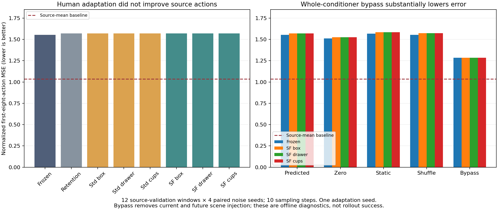

# SemanticFlow (SemFlow)

**Research question:** can an action model learn useful world knowledge from human video, then exploit it for downstream action adaptation?

This pilot adapts future scene representations from three personally recorded human RGB clips and ordinary task instructions. It does not retarget human movements into robot actions. A source-calibrated EgoSteer model predicts future features; a learned interface exposes those predictions to Panda action generation. Source robot demonstrations are required for calibration.

**Finding:** this implementation did not demonstrate useful action adaptation. SemFlow's mean improvement over a source-retention-only control was **0.0248%**. Every human-adapted model worsened sampled source action error relative to the frozen initialization. We paused this implementation; the broader research question remains open.

## Experiment and results

Starting from the same source-calibrated checkpoint, we compared frozen inference, standard future-feature adaptation, and semantic-state/transition adaptation (SemFlow). Each human task had one clip, one seed, and 60 updates per method. Only a shared rank-8 adapter with 1,605,632 parameters was adapted.

Source data comprised 248 training and 52 validation robot episodes across six tasks. The action panel sampled 12 validation windows with four paired action-noise seeds. These are not four independent training runs.

| Primary offline endpoint | Normalized first-eight-action MSE ↓ |
|---|---:|
| Source training-mean baseline | 1.036449 |
| Frozen common model | 1.552688 |
| Source-retention-only control | 1.570889 |
| SemFlow after each human clip | 1.570225–1.570691 |



Bypassing the entire scene conditioner lowered frozen error to 1.285209, about 17%, but still lost to the mean baseline. This removes current and future scene injection together; it does not isolate the forecast contribution. An earlier source simulator evaluation completed 17 trials with zero successes before timing out. No human-adapted target-task success result is claimed.

See the [research report and decision chain](docs/research_report.md).

## Reproduce the numbers

With Python 3.10 or later, from the repository root:

```bash
python3 tools/reproduce_results.py --results results
```

This standard-library command verifies evidence hashes and paired sample coverage, and recomputes the diagnostic decision. It does not rerun training or simulation. To regenerate the figure, install Matplotlib and NumPy, then run:

```bash
python3 tools/plot_submission.py
```

Software checks, with the optional research dependencies available:

```bash
PYTHONPATH=src:tools python3 -m unittest discover -s tests -q
```

See [reproducibility and v0 limits](docs/reproducibility.md) for evidence contents and GPU-stage documentation.

## Constraints and v0 scope

**Simulation-only: no robot hardware was available.** The application allowed two weeks, with a deadline of 16 October 2026, 23:59 BST. GPU experiments used a cloud A100 80 GB. Measured human-training peak allocation was 7.27 GiB; this is not a minimum GPU requirement. See [project information, time, and compute](docs/project_constraints.md).

This v0 includes research code, verified numerical evidence, a reproducible figure, and the experiment narrative. Video packaging and a clean-machine end-to-end training recipe remain pending. Human forecast losses measure fit to overlapping training-clip windows, not held-out human generalization. The planned multi-seed target rollout matrix was not run.

Upstream EgoSteer notices are preserved under [licenses/egosteer](licenses/egosteer/NOTICE). Model and dataset access and licenses apply separately. No project-wide reuse license has been selected for v0.
