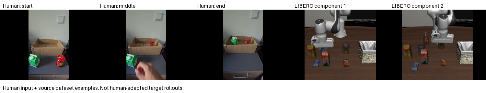
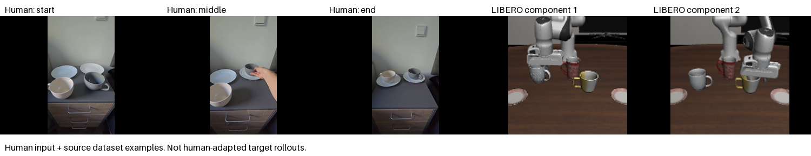
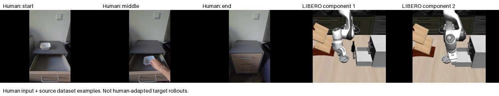

# Human demonstrations and intended LIBERO tasks

The three videos below are the personally collected chest-level RGB inputs used in adaptation. Each supplies one ordinary task instruction. There are no human action labels, states, masks, or event annotations.

The six simulator animations show recorded **LIBERO-90 source-dataset demonstrations**, each from `data/demo_0`, to illustrate the component tasks and scene. They do not show our learned policy, the combined LIBERO-10 task being executed, or successful transfer from the human clip. No target-task robot demonstrations were acquired for this showcase or used in adaptation.

## Two containers into a receptacle

[Full human video](../assets/demos/human-basket_two_foods.mp4) · [Animated preview](../assets/demos/human-basket_two_foods.gif)



Intended LIBERO-10 target:

`LIVING_ROOM_SCENE2_put_both_the_alphabet_soup_and_the_tomato_sauce_in_the_basket`

Source components illustrated:

- `LIVING_ROOM_SCENE2_pick_up_the_alphabet_soup_and_put_it_in_the_basket` — [dataset animation](../assets/demos/libero-basket_two_foods-component-1.gif)
- `LIVING_ROOM_SCENE2_pick_up_the_tomato_sauce_and_put_it_in_the_basket` — [dataset animation](../assets/demos/libero-basket_two_foods-component-2.gif)

## Two cups onto their respective plates

[Full human video](../assets/demos/human-mugs_two_plates.mp4) · [Animated preview](../assets/demos/human-mugs_two_plates.gif)



Intended LIBERO-10 target:

`LIVING_ROOM_SCENE5_put_the_white_mug_on_the_left_plate_and_put_the_yellow_and_white_mug_on_the_right_plate`

Source components illustrated:

- `LIVING_ROOM_SCENE5_put_the_white_mug_on_the_left_plate` — [dataset animation](../assets/demos/libero-mugs_two_plates-component-1.gif)
- `LIVING_ROOM_SCENE5_put_the_yellow_and_white_mug_on_the_right_plate` — [dataset animation](../assets/demos/libero-mugs_two_plates-component-2.gif)

## Bowl into a drawer, followed by closing it

[Full human video](../assets/demos/human-bowl_drawer_close.mp4) · [Animated preview](../assets/demos/human-bowl_drawer_close.gif)



Intended LIBERO-10 target:

`KITCHEN_SCENE4_put_the_black_bowl_in_the_bottom_drawer_of_the_cabinet_and_close_it`

Source components illustrated:

- `KITCHEN_SCENE4_put_the_black_bowl_in_the_bottom_drawer_of_the_cabinet` — [dataset animation](../assets/demos/libero-bowl_drawer_close-component-1.gif)
- `KITCHEN_SCENE4_close_the_bottom_drawer_of_the_cabinet` — [dataset animation](../assets/demos/libero-bowl_drawer_close-component-2.gif)

## What the correspondence means

The jar and carton substitute for alphabet soup and tomato sauce; a cardboard box substitutes for the basket. Cream and grey cups substitute for the white and yellow/white mugs while preserving the left/right destination relationship. A white bowl and household drawer substitute for the black bowl and bottom cabinet drawer, preserving the placement-then-closing sequence. Objects, embodiment, camera motion, scene geometry, and appearance differ. The experiment tests whether learned scene information can help bridge that difference; visual similarity alone is not evidence of transfer.

## Packaging and provenance

Full human MP4s are video-only remuxes: audio and original container metadata are omitted. Every decoded RGB frame and presentation timestamp is verified equal to the original input. Container hashes change, so [the packaged input manifest](../configs/human_clips.json) records the new hashes and original decoded timestamps. Original input hashes and verification results are preserved in [media provenance](../assets/demos/provenance.json). This manifest contains human clips only; merge it with the separately generated source index for GPU adaptation.

GIFs are presentation derivatives sampled at approximately six frames per second; they are not the training inputs and their timing is rounded to GIF precision. Contact sheets select start/middle/end human frames plus a middle frame from each source component. Source camera images are corrected from the recorded OpenGL orientation to upright display. These generated assets do not alter the curated numerical evidence.

LIBERO source images come from the [official dataset mirror](https://huggingface.co/datasets/yifengzhu-hf/LIBERO-datasets) at revision `f13aa24a3da8c43c7225569f28c562979fa0e35a`, already pinned in the project. Episode content hashes are checked against the source index before rendering. Task definitions follow [LIBERO](https://github.com/Lifelong-Robot-Learning/LIBERO); upstream copyright and MIT terms are retained under [licenses/libero](../licenses/libero/LICENSE). Human recordings were collected by the project author.

To rebuild with the existing external dataset and video/data dependencies installed:

```bash
PYTHONPATH=src:tools python3 tools/build_demo_showcase.py --data-root "$SEMFLOW_DATA_ROOT"
```

No simulation or GPU training is launched by this command. The [research report](research_report.md) describes the executed adaptation and negative offline results.
